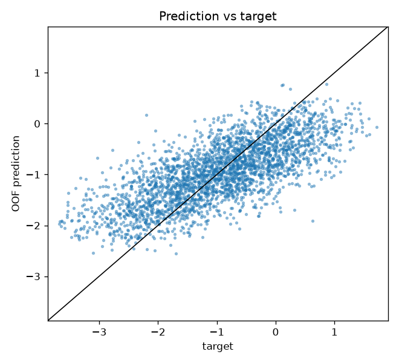
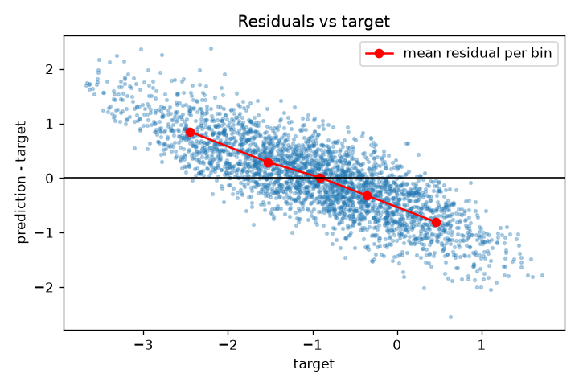
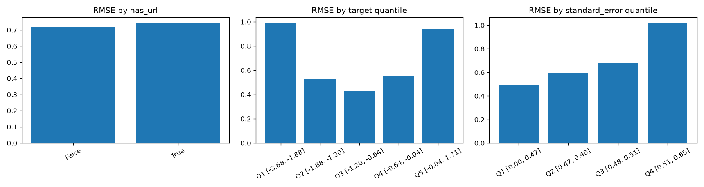
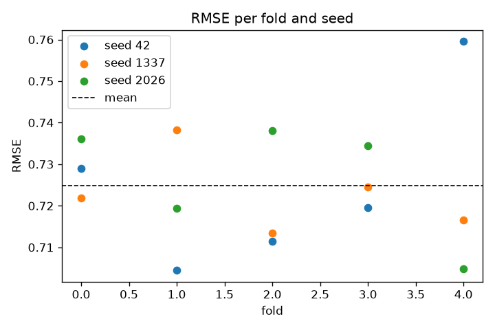

# CommonLit Readability - ДЗ№1

Источник задачи - 
[CommonLit Readability Prize](https://www.kaggle.com/competitions/commonlitreadabilityprize).

**Baseline:** TF-IDF + Ridge дает RMSE **0.725 ± 0.015** (5-fold CV x 3 сида) против 1.03 у константного предсказания.

## Содержание

1. [Постановка задачи](#1-постановка-задачи)
2. [Формализация задачи](#2-формализация-задачи)
3. [Данные (EDA)](#3-данные-eda)
4. [Baseline](#4-baseline)
5. [Протокол оценки](#5-протокол-оценки)
6. [Результаты baseline](#6-результаты-бейзлайна)
7. [Выводы](#7-выводы)
9. [Исследовательские вопросы](#8-исследовательские-вопросы)
10. [Запуск](#9-запуск)
11. [Структура репозитория](#10-структура-репозитория)

---

## 1. Постановка задачи

**Что предсказывается.** Легкость чтения (reading ease) англоязычного отрывка текста – непрерывная оценка, насколько текст легок для чтения школьникам 3–12 классов. Чем больше значение, тем легче текст.

**Объект предсказания.** Один отрывок текста (excerpt) длиной около 175 слов из литературы, научно-популярных и образовательных источников разных эпох.

**Данные на момент предсказания.** Только текст отрывка. Метаданные (`url_legal`, `license`) в скрытом тесте пустые, `standard_error` в тесте отсутствует.

**Практический смысл.** Учителям и составителям учебных программ нужно подбирать тексты подходящей сложности. Классические формулы опираются только на длину слов и предложений и плохо отражают реальную сложность. Коммерческие формулы закрыты или платные. Модель, оценивающая сложность по тексту, позволяет быстро и открыто размечать новые тексты.

**Ограничения задачи.**
- Небольшой объем данных: 2834 размеченных отрывка.
- Таргет получен из попарных сравнений текстов экспертами и содержит заметный шум (см. EDA).
- Сдвиг распределения: по описанию авторов, в тесте выше доля современных текстов.
- Приватный тест скрыт, поэтому оценка – локальная валидация на train.
- Английский язык.

### Основная гипотеза

**Формулировка.** Дообучение предобученного трансформера roberta-base с регрессионной головой (MSE-лосс) снизит RMSE относительно baseline TF-IDF + Ridge (0.725) не менее чем на 0.1, то есть до 0.625 и ниже

**Условия подтверждения.**
- RMSE считается на тех же фиксированных фолдах, что и у бейзлайна (5-fold x 3 сида).
- Улучшение значимо: 95% доверительный интервал парного bootstrap разницы RMSE по OOF-предсказаниям не включает 0.
- Улучшение сохраняется на срезе современных текстов (`has_url`).

**Обоснование.** Читаемость определяется не только набором слов, но и синтаксисом, связностью и знанием о частотности и редкости слов. Предобученная модель получает это из большого корпуса текстов, а TF-IDF бейзлайн – нет. Анализ ошибок бейзлайна частично подтверждает данное предположение: модель ошибается на текстах, где сложность определяется редкими терминами или смыслом.

**Порог.** Порог 0.1 зафиксирован после получения результатов бейзлайна, но до запуска основных экспериментов.

---

## 2. Формализация задачи

| | |
|---|---|
| **X** | текст отрывка `excerpt` (строка, около 175 слов) |
| **y** | `target` – оценка легкости чтения, вещественное число (в train от -3.68 до 1.71) |
| **Тип задачи** | регрессия |
| **Единица наблюдения** | один отрывок текста (document) |
| **Одно предсказание** | одно число – легкость чтения для одного отрывка |
| **Признаки на inference** | только `excerpt` |
| **Не используются как признаки** | `url_legal`, `license` (пусты в скрытом тесте), `standard_error` (нет в тесте), `id` |

---

## 3. Данные (EDA)

Полный EDA: [`notebooks/01_eda.ipynb`](notebooks/01_eda.ipynb), графики в [`reports/figures/`](reports/figures/).

**Источник.** `train.csv` и `test.csv` с Kaggle (CommonLit + Georgia State University). Полный корпус опубликован как [CLEAR Corpus](https://github.com/scrosseye/CLEAR-Corpus), но в работе он не используется

**Размер.** Train – 2834 отрывка. Доступный `test.csv` – 7 отрывков без таргета, для оценки не используется.

**Колонки и типы.**

| колонка | тип | пропуски в train | комментарий |
|---|---|---|---|
| `id` | строка | 0% | идентификатор |
| `url_legal` | строка | 70.7% | источник текста, пуст в скрытом тесте |
| `license` | строка | 70.7% | лицензия, пуста в скрытом тесте |
| `excerpt` | текст | 0% | единственный вход модели |
| `target` | float | 0% | таргет |
| `standard_error` | float | 0% | разброс оценок экспертов, только в train |

**Таргет.**
- Среднее -0.96, std 1.03, медиана -0.91.
- Распределение унимодальное, близкое к нормальному, с небольшим хвостом в сторону сложных текстов.
- Std таргета задает ориентир RMSE константного предсказания – около 1.03.
- Самые легкие тексты – детские тексты. Самые сложные – текст XIX века и Лавкрафт

**Шум в разметке.**
- `standard_error` в основном лежит в диапазоне 0.43–0.65, медиана 0.48. Это сопоставимо с RMSE сильных моделей на этой задаче, поэтому заметная часть ошибки, вероятно, неустранима.
- Зависимость SE от таргета U-образная: оценки самых легких и самых сложных текстов наименее надежны.
- Одна строка имеет `target = 0` и `standard_error = 0`. Это опорный текст шкалы Bradley–Terry, оставлен в данных.
- Найдена пара почти идентичных текстов (cosine similarity TF-IDF около 1.0) с таргетами 0.81 и 0.10 – пример шума разметки.

**Потенциальные источники leakage.**

- **`url_legal` / `license`.** Тексты с URL (29.3%) заметно легче: средний таргет -0.66 против -1.08. Источники – Simple Wikipedia, Frontiers for Young Minds, Wikipedia, African Storybook, то есть современные и детские тексты. Признак коррелирует с таргетом, но на inference недоступен. Поэтому `has_url` используется **только как срез** для анализа ошибок – как прокси современных текстов, доля которых в тесте выше.
- **Дубликаты.** Точных дубликатов нет, пар с cosine similarity > 0.5 всего 3 на 2834 текста. Влияние на CV пренебрежимо, GroupKFold не требуется.
- **Отрывки одного источника.** Например, найдены два отрывка "Алисы в стране чудес". Они могут попасть в разные фолды, и модель частично запомнит стиль автора. Для 70% текстов источник неизвестен, поэтому сгруппировать их нельзя. Это фундаментальное ограничение.

---

## 4. Baseline

**Модель.** TF-IDF по словам + Ridge-регрессия ([`src/models.py`](src/models.py))

**Почему так**
- Стандартная и общепринятая точка отсчета для текстовых задач
- Проверяет, сколько сигнала содержит сама лексика – без синтаксиса и предобученных знаний. Именно с этим сравнивается основная гипотеза.
- Быстрый: одно обучение около 0.7 с на CPU, а весь пайплайн меньше минуты
- Хорошо интерпретируемый: веса n-грамм показывают, что модель считает признаками легкого и сложного текста

**Почему он честный для бейзлайна**
- Одна линейная модель без ансамблей и стекинга.
- Нет внешних данных и предобученных моделей.
- Гиперпараметры заданы заранее в конфиге и **не подбирались** по валидации.

**Preprocessing.** Только внутри `TfidfVectorizer`: приведение к нижнему регистру и стандартная токенизация sklearn. Векторизатор обучается внутри Pipeline **только на train-части фолда**.

Зафиксированные гиперпараметры находятся в файле [`configs/baseline.yaml`](configs/baseline.yaml)

---
## 5. Протокол оценки

**Основная метрика – RMSE:**

$$\mathrm{RMSE} = \sqrt{\frac{1}{n}\sum_{i=1}^{n}(y_i - \hat{y}_i)^2}$$

где $y_i$ – истинный таргет, $\hat{y}_i$ – предсказание, $n$ – число объектов в валидационном фолде.

Почему RMSE:
- это официальная метрика соревнования задачи;
- она соответствует MSE-лоссу регрессии;
- сильнее штрафует крупные ошибки – промах на два уровня сложности хуже двух промахов на один.

**Дополнительные метрики.**
- MAE – устойчива к выбросам.
- R² – доля объясненной дисперсии.
- Pearson и Spearman – качество ранжирования текстов по сложности, что важно для практического применения.
- `dummy_rmse` – RMSE константы (среднее train-фолда) как sanity check.

**Разбиение.**
- 5-fold `StratifiedKFold` со стратификацией по 10 квантилям таргета.
- Повторяется с 3 сидами (42, 1337, 2026), всего 15 обучений.
- Фолды создаются один раз (`src/data.py`) и сохраняются в `data/folds.csv`. **Все модели, включая будущие, сравниваются на одних и тех же фолдах.**

**Почему такой split корректен.**
- Данные не являются временным рядом, у объектов нет общих групп (дубликатов практически нет). Поэтому подходит случайное разбиение.
- Стратификация по квантилям выравнивает распределение таргета между фолдами - средние по фолдам от -0.95 до -0.97, std от 1.01 до 1.06.
- Повтор по сидам показывает, насколько оценка зависит от конкретного разбиения.

**Защита от ликов.**
- TF-IDF обучается внутри Pipeline только на train-части фолда.
- `url_legal`, `license`, `standard_error` в модель не подаются.
-  Test не используется для выбора модели.

**Как оценивается результат.**
- mean ± std метрик по 15 фолдам.
- OOF RMSE (по out-of-fold предсказаниям) для каждого сида.
- 95% bootstrap доверительный интервал OOF RMSE (2000 ресемплов).
- Срезы: `has_url`, квинтили таргета, квартили standard_error

**Выбор лучшей модели.** Только по mean RMSE на этих фолдах. Модели сравниваются на одних и тех же фолдах с парным bootstrap разницы RMSE по OOF-предсказаниям. Улучшение, которое не выходит за доверительный интервал разницы, не считается улучшением.

---

## 6. Результаты baseline

Полный автоматический отчет по выполнению: [`reports/tfidf_ridge/results.md`](reports/tfidf_ridge/results.md), метрики по фолдам: [`reports/tfidf_ridge/fold_metrics.csv`](reports/tfidf_ridge/fold_metrics.csv).

**Метрики (mean ± std по 15 фолдам).**

| метрика | TF-IDF + Ridge | константа (sanity check) |
|---|---|---|
| **RMSE** | **0.725 ± 0.015** | 1.033 ± 0.015 |
| MAE | 0.579 ± 0.013 | – |
| R² | 0.508 ± 0.020 | – |
| Pearson | 0.726 ± 0.016 | – |
| Spearman | 0.728 ± 0.019 | – |
| время обучения, с | 0.67 ± 0.04 | – |

**OOF RMSE по сидам с 95% bootstrap ДИ.**

| сид | OOF RMSE | 95% ДИ |
|---|---|---|
| 42 | 0.7251 | [0.707, 0.744] |
| 1337 | 0.7230 | [0.705, 0.742] |
| 2026 | 0.7267 | [0.709, 0.745] |

Разброс OOF RMSE между сидами – 0.002, между отдельными фолдами – 0.015. Оценка устойчива к разбиению.

**Ошибки по квинтилям таргета (OOF, сид 42).** `bias` – среднее (предсказание – таргет).

| квинтиль таргета | RMSE | bias |
|---|---|---|
| Q1 [-3.68, -1.88] (самые сложные) | 0.990 | +0.852 |
| Q2 [-1.88, -1.20] | 0.523 | +0.292 |
| Q3 [-1.20, -0.64] | 0.427 | +0.011 |
| Q4 [-0.64, -0.04] | 0.556 | -0.319 |
| Q5 [-0.04, 1.71] (самые легкие) | 0.939 | -0.805 |

**Срез `has_url` (прокси современных текстов).**

| срез | n | RMSE | bias |
|---|---|---|---|
| без URL | 2004 | 0.718 | +0.077 |
| с URL | 830 | 0.743 | -0.164 |

**Срез по `standard_error`.** RMSE растет с SE: 0.50 в первом квартиле и 1.02 в последнем. Высокий SE приходится на края шкалы, где действует сжатие предсказаний, поэтому по этой таблице нельзя отделить влияние шума разметки от сжатия.

**Сжатие к среднему.** std(предсказаний) / std(таргета) = 0.59, наклон остатков по таргету -0.57.

**Графики** (`reports/tfidf_ridge/figures/`):

| | |
|---|---|
|  |  |
| Предсказания сжаты относительно диагонали | Средний остаток линейно падает с таргетом |
|  |  |
| Ошибка максимальна на краях шкалы | RMSE стабилен по фолдам и сидам |

**Типичные ошибки** (полный список: [`reports/tfidf_ridge/error_examples.csv`](reports/tfidf_ridge/error_examples.csv)):

1. **Научно-популярный текст предсказан легче, чем есть.** Текст о биомаркерах черепно-мозговой травмы: target -3.03, предсказание -0.67. Синтаксис современный и простой, а сложность – в специальных терминах. Редкие термины либо отсекаются `min_df = 2`, либо получают малый вес: модель не знает, что слово сложное
2. **Энциклопедический текст предсказан сложнее, чем есть.** Статья о пустыне Сахара: target 1.10, предсказание -0.95. Много «of», «which», длинные описательные конструкции, которые модель выучила как признаки сложности, хотя по смыслу текст простой
3. **Возможный шум разметки.** Очень простой детский текст об эмоциях («Yuadoo is scared of the dark...») имеет target -2.20, предсказание 0.18. По содержанию текст легкий, поэтому ошибка может быть связана с качеством разметки.

**Что выучила модель** (веса модели на всём train):
- **признаки легкого текста** – местоимения и нарратив: *you, she, they, one day, said, mother, school*;
- **признаки сложного текста** – служебные слова: *of, which, with, as, thus, such, its, being*.

Модель в основном опирается не на смысл, а на служебные слова как на прокси синтаксической сложности (длинные именные группы, придаточные).

---

## 7. Выводы

**Что получилось.**
- Воспроизводимый пайплайн с фиксированными фолдами и честным протоколом.
- Бейзлайн снижает RMSE с 1.033 (константа) до 0.725 и объясняет около 51% дисперсии. Это заметно больше, чем любой одиночный классический readability-признак (около 30%).
- Оценка устойчива к разбиению (разброс между сидами 0.002), что делает бейзлайн надежной точкой отсчета.

**Где бейзлайн слаб.**
- **Сильное сжатие предсказаний к среднему.** На краях шкалы RMSE 0.94–0.99 против 0.43 в центре. Сложные тексты систематически предсказываются легче, легкие – сложнее. При R² около 0.5 естественное отношение std предсказаний к std таргета – около 0.71; полученное значение 0.59 указывает, что `alpha = 1.0`, вероятно, слишком сильно регуляризует.
- **Современные тексты** (`has_url`) предсказываются сложнее, чем есть (bias -0.16). Часть этого смещения объясняется сжатием: такие тексты в среднем легче.
- **У модели нет знаний о редкости слов вне обучающей выборки и нет понимания смысла:** ошибки на научно-популярных и энциклопедических текстах.

**Следующая гипотеза.** Основная гипотеза проекта: дообученный roberta-base снизит RMSE до ≤ 0.625. Типичные ошибки бейзлайна лежат как раз там, где нужны контекст и знания о словах из предобучения.

**Ограничения текущего решения.**
- Оценка только по CV на train.
- Возможная утечка стиля между отрывками одного источника в разных фолдах – CV может быть слегка оптимистичным.
- Гиперпараметры не подбирались. Это сделано намеренно, чтобы бейзлайн оставался честной точкой отсчета, но бейзлайн, вероятно, не оптимален.
- Заметная часть ошибки обусловлена шумом разметки и не может быть устранена никакой моделью.

## 8. Исследовательские вопросы

Каждый вопрос сравнивается с бейзлайном на тех же фолдах (5-fold x 3 сида). Улучшение засчитывается, только если 95% ДИ парного bootstrap разницы RMSE не включает 0.

**Вопросы к бейзлайну**

- **Устраняет ли подбор `alpha` во вложенной CV избыточное сжатие предсказаний?**
   - Что сравниваем: Ridge с `alpha`, подобранным на внутренних фолдах каждого внешнего фолда, против `alpha = 1.0`.
   - Метрики: общий RMSE, RMSE и bias на Q1/Q5 таргета, отношение std(предсказаний) / std(таргета) – сейчас 0.59.

- **Дают ли классические readability-признаки прирост поверх TF-IDF?**
   - Что сравниваем: TF-IDF + 12 признаков из `src/features.py` (стандартизированных внутри фолда) против одного TF-IDF.
   - Мотивация: признаки связаны с таргетом (|Spearman| до 0.56) и явно кодируют длину предложений и слогов, которую мешок слов видит лишь косвенно.

**Вопросы к основной гипотезе**

- **Какая часть выигрыша трансформера объясняется предобученными представлениями, а какая – дообучением?**
   - Что сравниваем: замороженные эмбеддинги roberta-base (mean pooling) + Ridge против полного fine-tuning roberta-base и против baseline.
   - Если замороженные эмбеддинги дают большую часть выигрыша, основной вклад – знания из предобучения, а не адаптация к задаче.

- **Насколько результат fine-tuning чувствителен к сиду?**
   - Что сравниваем: разброс OOF RMSE по 3 сидам инициализации и порядка батчей на фиксированных фолдах с разбросом бейзлайна (0.002).
   - Цель: определить, сколько запусков нужно, чтобы надежно сравнивать варианты трансформера между собой.

**Вопрос к данным и протоколу**

- **Завышает ли случайный CV качество из-за отрывков одного источника в разных фолдах?**
   - Что сравниваем: для текстов с известным источником (`url_legal`, 830 шт.) RMSE бейзлайна при группировке по домену (GroupKFold) и при текущем стратифицированном разбиении.
   - Если ошибка при группировке заметно выше, протокол нужно менять на групповой там, где источник известен.

---

## 9. Запуск

**Окружение** (Python 3.11):

```bash
conda create -n rnd-hw1 python=3.11 -y
conda activate rnd-hw1
pip install -r requirements.txt
```

или

```bash
python3 -m venv .venv
source .venv/bin/activate
pip install -r requirements.txt
```

**Данные.** Скачать `train.csv`, `test.csv`, `sample_submission.csv` со страницы [соревнования](https://www.kaggle.com/competitions/commonlitreadabilityprize/data) и положить в `data/`:

```bash
kaggle competitions download -c commonlitreadabilityprize -p data
unzip data/commonlitreadabilityprize.zip -d data
```

**Baseline целиком** (фолды → обучение по CV → оценка) (минуты на CPU):

```bash
bash scripts/run_baseline.sh
```

Или по шагам:

```bash
python -m src.data --config configs/baseline.yaml
python -m src.train --config configs/baseline.yaml
python -m src.evaluate --config configs/baseline.yaml
```

Результаты появятся в `reports/tfidf_ridge/`:

Модель на всем train сохраняется в `models/tfidf_ridge.joblib`.

**EDA:** `notebooks/01_eda.ipynb`. Перед запуском нужны данные в `data/` и фолды (`python -m src.data`).

---

## 10. Структура репозитория

```text
.
├── README.md
├── requirements.txt
├── configs/
│   └── baseline.yaml          # пути, параметры CV, гиперпараметры модели и оценки
├── data/                      # не в git: train.csv, test.csv, folds.csv
├── notebooks/
│   └── 01_eda.ipynb           # EDA
├── reports/
│   ├── figures/               # графики EDA
│   └── tfidf_ridge/           # результаты бейзлайна
├── scripts/
│   └── run_baseline.sh        # фолды + обучение + оценка
└── src/
    ├── data.py                # загрузка данных, фиксированные фолды
    ├── features.py            # классические readability-признаки (EDA)
    ├── models.py              # baseline TF-IDF + Ridge
    ├── train.py               # CV-обучение, OOF, модель на всем train
    ├── evaluate.py            # метрики, bootstrap, срезы, ошибки, графики
    └── utils.py               # конфиг, сиды, метрики
```