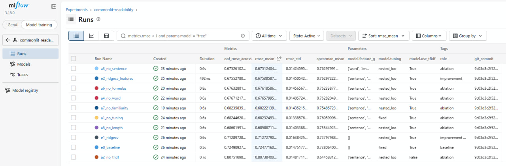
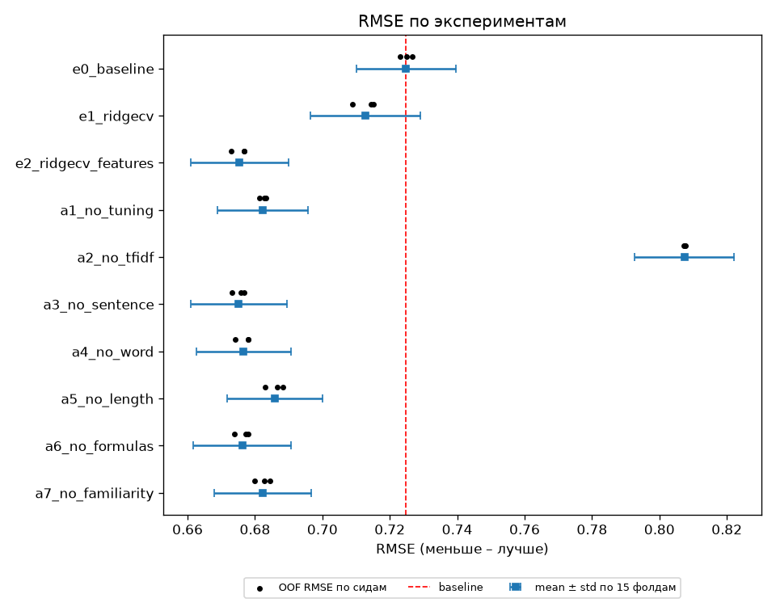
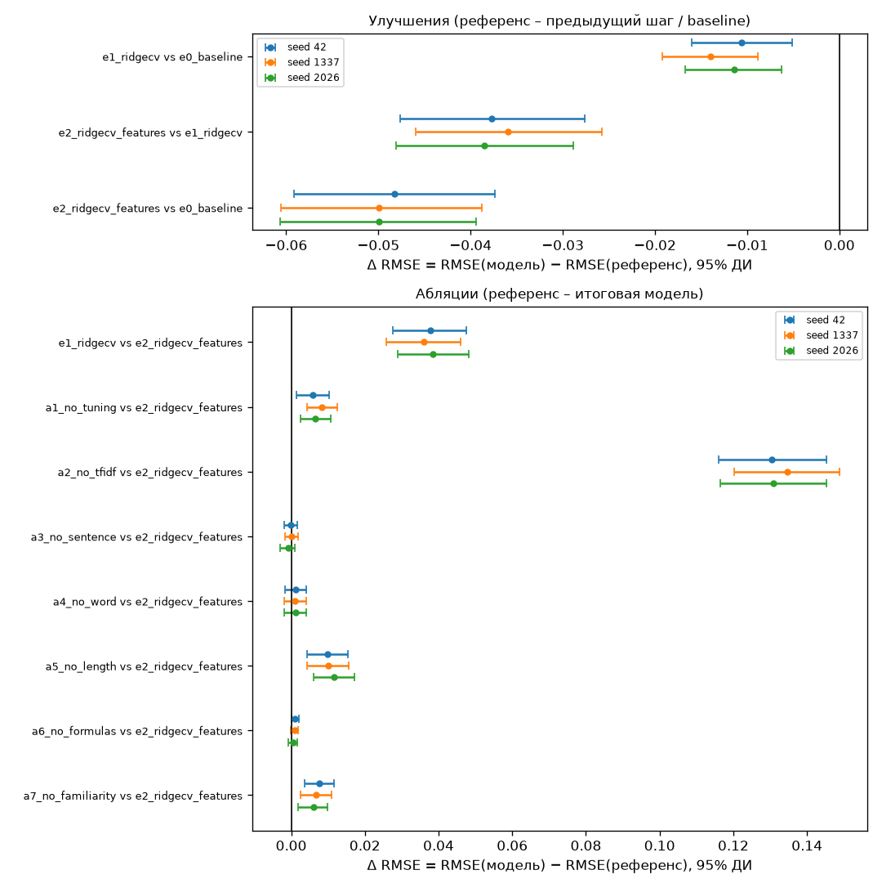
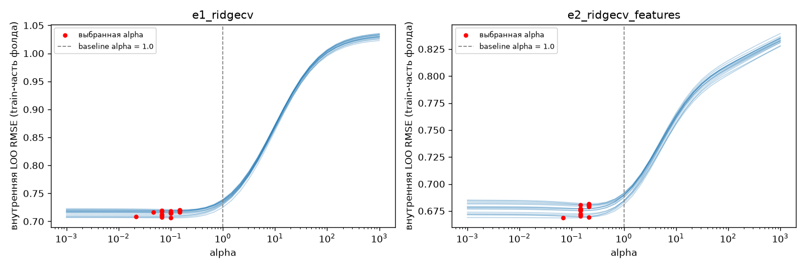
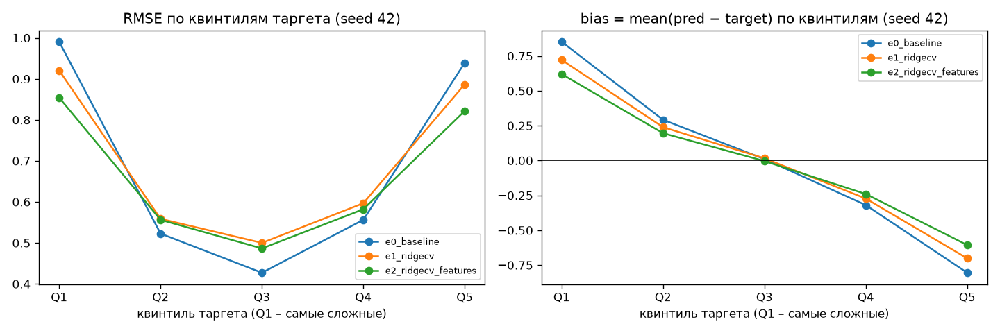
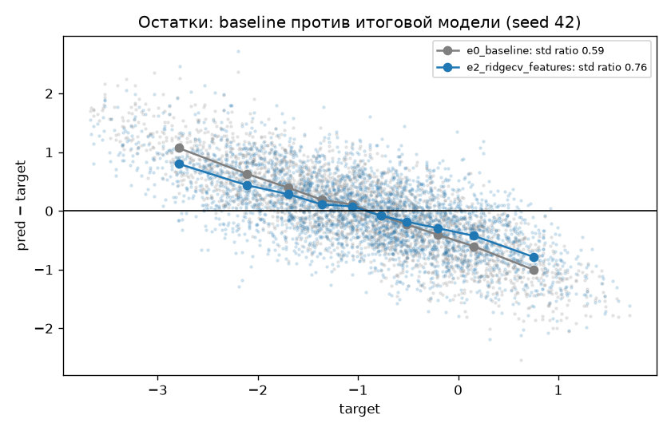
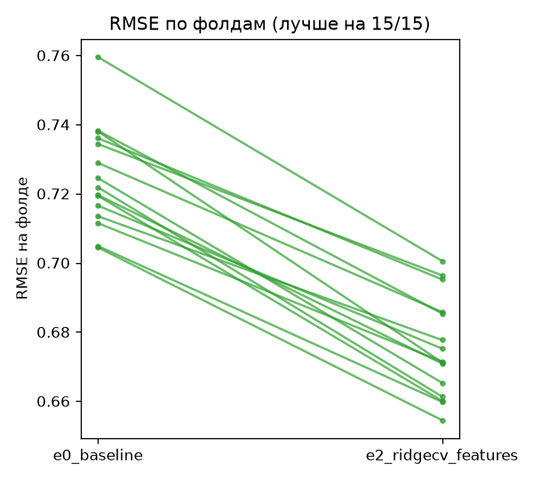
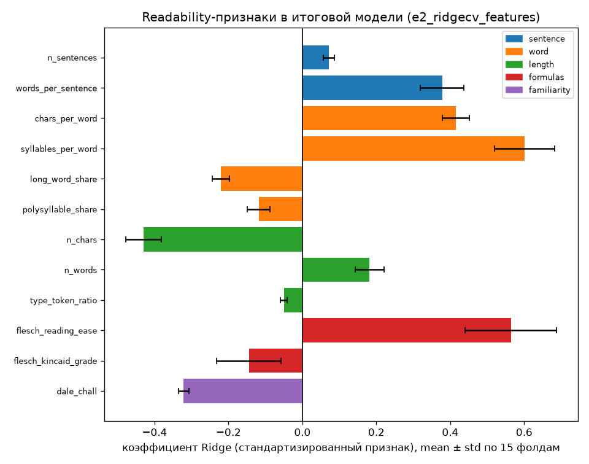

# CommonLit Readability – ДЗ№2

Продолжение [ДЗ№1](../tfidf_ridge/report.md)

Итог: вложенный подбор силы регуляризации и 12 readability-признаков снижают RMSE с 0.725 до 0.675 (лучше на 15 из 15 фолдов). Оба улучшения значимы. Из 7 абляций 4 показали значимый вклад компонента, 3 оказались шумом.

## Содержание

1. [Исходная точка и мотивация](#1-исходная-точка-и-мотивация)
2. [Улучшения и гипотезы](#2-улучшения-и-гипотезы)
3. [Дизайн экспериментов](#3-дизайн-экспериментов)
4. [Честное сравнение](#4-честное-сравнение)
5. [Трекинг экспериментов](#5-трекинг-экспериментов)
6. [Результаты](#6-результаты)
7. [Резюме абляций](#7-резюме-абляций)
8. [Выводы](#8-выводы)
9. [Запуск и артефакты](#9-запуск-и-артефакты)

---

## 1. Исходная точка и мотивация

Бейзлайн ДЗ1: TF-IDF (слова и биграммы) + Ridge с `alpha = 1.0`, RMSE 0.7248 ± 0.0148 на 5-fold CV x 3 сида. Анализ  ошибок в ДЗ1 выявил две слабости, из которых выведены улучшения:

1. Сильное сжатие предсказаний к среднему.
2. N-грамм бэг видит синтаксическую сложность только косвенно.

---

## 2. Улучшения и гипотезы

### Улучшение 1 – вложенный подбор alpha (E1)

> Мы считаем, что `alpha = 1.0` пере-регуляризует модель: на это указывают отношение std 0.59 при ожидаемых около 0.73 и наклон калибровки 1.23. Поэтому пробуем подбирать alpha по внутренней leave-one-out ошибке только на train-части каждого внешнего фолда.
>
> Ожидание: выбранная alpha < 1 и стабильна по фолдам; отношение std растет, наклон калибровки приближается к 1; ошибка на крайних квинтилях снижается, общий RMSE значимо снижается.

### Улучшение 2 – 12 readability-признаков (E2)

> Мы считаем, что явные readability-признаки несут информацию, которой нет в n-граммах: длину предложений, число слогов, долю слов вне списка знакомых слов Dale–Chall, длину отрывка. Поэтому пробуем добавить к TF-IDF 12 признаков из `src/features.py` (стандартизация внутри фолда) при вложенном подборе alpha.
>
> Ожидание: RMSE значимо ниже E1, эффект умеренный, так как часть сигнала уже покрыта n-граммами.

Подбор alpha – прямое исправление диагностированной проблемы.Добавление 12 плотных признаков меняет оптимальную регуляризацию, поэтому признаки добавляются поверх уже подбираемой alpha, а не при фиксированной `alpha = 1.0`.

---

## 3. Дизайн экспериментов

10 экспериментов – конфиги в [`configs/experiments/`](../../configs/experiments/):

| ID | Модель | Роль |
|---|---|---|
| E0 | TF-IDF + Ridge, alpha = 1.0 | бейзлайн ДЗ1 (перезапуск, контроль воспроизведения) |
| E1 | TF-IDF + подбор alpha | улучшение 1(по сути также абляция - итоговая модель без признаков) |
| E2 | TF-IDF + 12 признаков + подбор alpha | улучшение 2, итоговая модель |
| A1 | E2 без подбора alpha (alpha = 1.0) | абляция регуляризации |
| A2 | E2 без TF-IDF | абляция лексического блока |
| A3 | E2 без группы sentence | абляция группы признаков |
| A4 | E2 без группы word | абляция группы признаков |
| A5 | E2 без группы length | абляция группы признаков |
| A6 | E2 без группы formulas | абляция группы признаков |
| A7 | E2 без группы familiarity | абляция группы признаков |

Улучшения применяются последовательно (E0 → E1 → E2). Все абляции – leave-one-out от итоговой модели E2: убирается ровно один компонент, остальное сохраняется.

Группы признаков зафиксированы заранее

| Группа | Признаки | Что кодирует |
|---|---|---|
| sentence | `n_sentences`, `words_per_sentence` | длину предложений |
| word | `chars_per_word`, `syllables_per_word`, `long_word_share`, `polysyllable_share` | поверхностную сложность слов |
| length | `n_chars`, `n_words`, `type_token_ratio` | длину отрывка и лексическое разнообразие |
| formulas | `flesch_reading_ease`, `flesch_kincaid_grade` | готовые формулы – линейные комбинации длины предложений и слогов на слово |
| familiarity | `dale_chall` | долю слов вне списка около 3000 знакомых слов – единственный признак с внешним знанием о частотности слов |

Группы, а не отдельные признаки, выбраны потому, что признаки внутри группы сильно коррелируют: удаление одного из них компенсировалось бы похожими. Кроме того, 5 сравнений вместо 12 снижают риск множественных сравнений.

Ожидания для каждой абляции записаны в конфигах до запуска и сопоставлены с результатами в разделе 6.3.

---

## 4. Честное сравнение

### Что одинаково во всех экспериментах и как это контролируется

| Условие | Как зафиксировано | Как проверено |
|---|---|---|
| Один и тот же train/val split | фолды созданы один раз в ДЗ1 (`data/folds.csv`, 5-fold со стратификацией по 10 квантилям таргета, сиды 42, 1337, 2026) | SHA-256 файла фолдов записывается в `metrics.json` каждого эксперимента|
| Одна и та же метрика | RMSE – основная; MAE, R², Spearman, срезы – дополнительные | все метрики пересчитываются одним кодом в `src/compare.py` из OOF-предсказаний, а не берутся из логов отдельных запусков |
| Одинаковый preprocessing | параметры TF-IDF общие для всех (`common.yaml`) и совпадают с бейзлайном ДЗ1 | `src/registry.py` проверяет совпадение с `configs/baseline.yaml` и одинаковость общих секций у всех экспериментов |
| Одинаковый решатель | точное решение Ridge (`RidgeCV`) и для фиксированной, и для подбираемой alpha | E0 воспроизводит ДЗ1|
| Ровно один изменяемый компонент | каждое улучшение объявляет `adds`, каждая абляция – `removes` | `src/registry.py` вычисляет фактическую разницу конфигов и падает, если она не совпадает с заявленной |

### Защита от утечек

- TF-IDF и `StandardScaler` обучаются внутри фолда в sklearn-Pipeline – только на train-части.
- alpha подбирается вложенно. `RidgeCV` выбирает alpha по leave-one-out ошибке на train-части внешнего фолда: валидационный фолд не участвует ни в выборе alpha, ни в обучении. Итоговый RMSE – оценка всей процедуры модель + подбор alpha
- Readability-признаки детерминированы и считаются по каждому тексту отдельно, без обучения.
- Признаки, недоступные на inference, не используются: `url_legal`, `license`, `standard_error`. `has_url`
- Тест не используются в принципе. Все решения принимаются только по локальной CV.

### Что зафиксировано до запуска

Сетка alpha, правило границ сетки, группы признаков, ожидания по каждому эксперименту, параметры bootstrap и правило вердикта записаны в конфигах и закоммичены до  запуска экспериментов на реальных данных 


### Правило вердикта

Δ = RMSE(модель) − RMSE(референс), считается на одних и тех же OOF-предсказаниях.

- Значимость – парный bootstrap: 5000 ресемплов текстов, одни и те же индексы для обеих моделей, 95% ДИ, отдельно для каждого из 3 сидов разбиения.
- "Значимо лучше / хуже" – только если ДИ не включает 0 на всех трех сидах и |Δ| ≥ 0.005.
- "Значимо, но пренебрежимо" – ДИ не включает 0, но |Δ| < 0.005. На реальных данных этот случай не встретился.
- "Незначимо" – иначе.

Порог 0.005 – около трети разброса RMSE между фолдами (0.015) и меньше 1% от RMSE бейзлайна.

### Воспроизведение бейзлайна

E0 запускается новым кодом и сравнивается с предсказаниями ДЗ1 (`reports/tfidf_ridge/oof.csv`): max |ΔRMSE| по сидам = 5.8e-07, max |Δpred| = 1.5e-04. Расхождение предсказаний – погрешность итеративного решателя в ДЗ1; модель, функция потерь, фолды и метрика те же. Результат в [`tables/checks.json`](tables/checks.json).

### Остаточные риски

- Идеи обоих улучшений получены из анализа OOF-предсказаний бейзлайна, то есть из валидации. Сам подбор вложенный, но выбор того, что улучшать, сделан по валидационным ошибкам.
- Внутренний LOO слегка оптимистичен: TF-IDF и scaler обучены на всей train-части, включая выкидываемый текст. Это влияет только на выбор alpha, не на внешнюю оценку.
- 11 сравнений – множественные сравнения. Требование значимости на всех трех сидах частично это сдерживает, но не является строгой поправкой: сиды делят одни и те же тексты.
- Bootstrap по текстам учитывает неопределенность выборки текстов, но не изменчивость обучения на разных подвыборках. Ее частично отражают три сида и 15 фолдов.
- Отрывки одного источника могут попадать в разные фолды – ограничение из ДЗ1, одинаковое для всех экспериментов, поэтому на сравнение не влияет.

---

## 5. Трекинг экспериментов

Использовался MLflow. Для каждого запуска логируются:

- теги: ID, роль (`baseline` / `improvement` / `ablation`), гипотеза, родительский эксперимент или итоговая модель для абляций, git commit, флаг незакоммиченных изменений, SHA-256 фолдов и данных, версии Python и sklearn;
- параметры: модель (`use_tfidf`, `feature_groups`, `tuning`), сиды, общие параметры TF-IDF и сетки;
- метрики: mean и std по 15 фолдам, OOF RMSE по каждому сиду, `rmse_fold` по шагам;
- артефакты: `oof.csv`, `metrics.json`, `config.json`.



*Все 10 запусков, отсортированы по RMSE. Видны метрики, параметры модели, роль и git commit.*

---

## 6. Результаты

### Таблица экспериментов

| ID | Модель | RMSE (фолды) | OOF RMSE (сиды) | R² | Spearman | std ratio | Наклон калибр. | RMSE Q1 | RMSE Q5 | RMSE URL | alpha (медиана) |
|---|---|---|---|---|---|---|---|---|---|---|---|
| E0 | TF-IDF + Ridge (1.0) | 0.7248 ± 0.0148 | 0.7249 ± 0.0018 | 0.508 | 0.728 | 0.590 | 1.229 | 0.991 | 0.940 | 0.747 | – |
| E1 | TF-IDF + подбор alpha | 0.7127 ± 0.0164 | 0.7129 ± 0.0034 | 0.524 | 0.728 | 0.699 | 1.036 | 0.921 | 0.888 | 0.740 | 0.100 |
| **E2** | **TF-IDF + признаки + подбор alpha** | **0.6754 ± 0.0145** | **0.6755 ± 0.0022** | **0.573** | **0.764** | **0.754** | **1.003** | **0.854** | **0.825** | **0.707** | **0.147** |
| A1 | E2 без подбора alpha | 0.6823 ± 0.0134 | 0.6824 ± 0.0010 | 0.564 | 0.761 | 0.705 | 1.067 | 0.890 | 0.849 | 0.712 | – |
| A2 | E2 без TF-IDF | 0.8074 ± 0.0148 | 0.8075 ± 0.0001 | 0.389 | 0.644 | 0.630 | 0.991 | 1.096 | 1.026 | 0.839 | 0.068 |
| A3 | E2 без sentence | 0.6751 ± 0.0142 | 0.6753 ± 0.0019 | 0.573 | 0.763 | 0.754 | 1.004 | 0.852 | 0.824 | 0.704 | 0.147 |
| A4 | E2 без word | 0.6766 ± 0.0141 | 0.6767 ± 0.0022 | 0.571 | 0.763 | 0.750 | 1.007 | 0.858 | 0.828 | 0.704 | 0.147 |
| A5 | E2 без length | 0.6859 ± 0.0140 | 0.6860 ± 0.0027 | 0.559 | 0.756 | 0.742 | 1.009 | 0.847 | 0.861 | 0.714 | 0.100 |
| A6 | E2 без formulas | 0.6762 ± 0.0146 | 0.6763 ± 0.0021 | 0.572 | 0.763 | 0.754 | 1.003 | 0.854 | 0.827 | 0.707 | 0.147 |
| A7 | E2 без familiarity | 0.6822 ± 0.0144 | 0.6824 ± 0.0024 | 0.564 | 0.756 | 0.747 | 1.006 | 0.877 | 0.819 | 0.715 | 0.147 |

- `Q1` / `Q5` – самые сложные / самые легкие 20% текстов
- `URL` – срез современных текстов. Все сиды усреднены.

### Таблица сравнений

| Тип | Сравнение | Δ RMSE | 95% ДИ по сидам | Фолдов лучше | Вердикт |
|---|---|---|---|---|---|
| улучшение | E1 vs E0 | −0.0120 | [−0.016, −0.005], [−0.019, −0.009], [−0.017, −0.006] | 15/15 | значимо лучше |
| улучшение | E2 vs E1 | −0.0374 | [−0.048, −0.028], [−0.046, −0.026], [−0.048, −0.029] | 15/15 | значимо лучше |
| итог | E2 vs E0 | −0.0494 | [−0.059, −0.037], [−0.061, −0.039], [−0.061, −0.039] | 15/15 | значимо лучше |
| абляция | E1 (без признаков) vs E2 | +0.0374 | [+0.028, +0.048], [+0.026, +0.046], [+0.029, +0.048] | 0/15 | значимо хуже |
| абляция | A1 (без подбора alpha) vs E2 | +0.0069 | [+0.001, +0.010], [+0.004, +0.012], [+0.002, +0.011] | 1/15 | значимо хуже |
| абляция | A2 (без TF-IDF) vs E2 | +0.1320 | [+0.116, +0.145], [+0.120, +0.149], [+0.116, +0.145] | 0/15 | значимо хуже |
| абляция | A3 (без sentence) vs E2 | −0.0003 | [−0.002, +0.002], [−0.002, +0.002], [−0.003, +0.001] | 5/15 | незначимо |
| абляция | A4 (без word) vs E2 | +0.0012 | [−0.002, +0.004], [−0.002, +0.004], [−0.002, +0.004] | 7/15 | незначимо |
| абляция | A5 (без length) vs E2 | +0.0105 | [+0.004, +0.015], [+0.004, +0.016], [+0.006, +0.017] | 1/15 | значимо хуже |
| абляция | A6 (без formulas) vs E2 | +0.0008 | [−0.000, +0.002], [−0.000, +0.002], [−0.001, +0.002] | 4/15 | незначимо |
| абляция | A7 (без familiarity) vs E2 | +0.0068 | [+0.004, +0.012], [+0.003, +0.011], [+0.002, +0.010] | 0/15 | значимо хуже |

Для абляций референс – итоговая модель, поэтому положительная Δ означает, что удаленный компонент полезен. "Фолдов лучше" – на скольких из 15 фолдов RMSE модели ниже, чем у референса.



*RMSE по экспериментам: квадрат – mean ± std по 15 фолдам, точки – OOF RMSE по каждому сиду, пунктир – бейзлайн. Без TF-IDF (A2) модель резко хуже, остальные абляции группируются около E2.*




### 6.1. Улучшение 1 – подбор alpha

Результат: RMSE 0.7248 → 0.7127 (Δ = −0.012, значимо на всех сидах, лучше на 15/15 фолдах). Гипотеза подтверждена, включая механизм:

| | E0 | E1 | Ожидание |
|---|---|---|---|
| alpha | 1.0 | медиана 0.10, диапазон 0.02–0.15 | < 1, стабильна – да |
| std ratio | 0.590 | 0.699 | растет – да |
| Наклон калибровки | 1.229 | 1.036 | к 1 – да |
| RMSE Q1 / Q5 | 0.991 / 0.940 | 0.921 / 0.888 | снижаются – да |
| Spearman | 0.728 | 0.728 | – |




Два важных уточнения:
- Spearman не изменился (0.728). Подбор alpha исправил масштаб предсказаний, но не порядок текстов по сложности. Весь выигрыш E1 – калибровка.
- Это компромисс: края шкалы улучшились, а центр ухудшился – RMSE на Q3 около 0.43 → 0.50 на сиде 42. Менее сжатые предсказания сильнее разбросаны и в середине. В сумме RMSE ниже.

### 6.2. Улучшение 2 – readability-признаки

Результат: RMSE 0.7127 → 0.6754 (Δ = −0.037, значимо, 15/15 фолдов). Гипотеза подтверждена; эффект больше, чем ожидалось до запуска.

- В отличие от подбора alpha, признаки улучшили ранжирование: Spearman 0.728 → 0.764, R² 0.524 → 0.573.
- Калибровка итоговой модели почти идеальна: наклон 1.003.
- Срез современных текстов (has_url) улучшился: RMSE 0.747 → 0.707 от E0 к E2, смещение −0.16 → −0.12. Улучшение сохраняется там, где тестовые данные сдвинуты.









*RMSE бейзлайна и итоговой модели на каждом из 15 фолдов: улучшение на всех.*

### 6.3. Абляции

| Абляция (из E2) | Δ RMSE | Вердикт | Ожидание до запуска | Совпало? |
|---|---|---|---|---|
| без всех признаков (= E1) | +0.037 | значимо хуже | хуже | да |
| A1 без подбора alpha | +0.007 | значимо хуже | хуже, сжатие возвращается | да: std ratio 0.754 → 0.705, наклон 1.003 → 1.067 |
| A2 без TF-IDF | +0.132 | значимо хуже | сильно хуже, лексика – основной сигнал | да |
| A3 без sentence | −0.0003 | незначимо | мал или незначим (дублируется формулами) | да |
| A4 без word | +0.001 | незначимо | мал или незначим (дублируется формулами) | да |
| A5 без length | +0.010 | значимо хуже | незначимо | нет |
| A6 без formulas | +0.001 | незначимо | незначимо | да |
| A7 без familiarity | +0.007 | значимо хуже | наибольший вклад среди групп | частично: значим, но второй после length |





Коэффициенты по отдельности интерпретировать нельзя. Признаки сильно коллинеарны: Flesch и Flesch–Kincaid почти линейно выражаются через `words_per_sentence` и `syllables_per_word`. Модель распределяет веса между ними произвольно, с компенсацией. Отсюда ротиворечащие смыслу знаки, например положительный коэффициент у `syllables_per_word`. Вклад признаков поэтому оценивается только групповыми абляциями, а график иллюстрирует, почему так.

### 6.4. Примеры ошибок итоговой модели

Крупнейшие ошибки E2 на OOF (сид 42), рядом – предсказание бейзлайна. Полный список: [`tables/error_examples_final.csv`](tables/error_examples_final.csv).

| Текст | target | E0 | E2 | Что происходит |
|---|---|---|---|---|
| "Probably the most widely accepted theory explaining the evolution of larval stages…" (научпоп) | −2.78 | −0.52 | −0.31 | Ошибка не исправлена. Синтаксис современный и простой, сложность – в терминах (sessile, tunicates). Признаки длины и формулы считают текст легким, Dale–Chall не перевешивает |
| "Yuadoo is scared of the dark. Everyone feels fear sometimes…" (детский текст) | −2.20 | 0.18 | 0.52 | Вероятный шум разметки. Короткие предложения и простые слова; признаки сдвинули предсказание еще ближе к легкому, а метка говорит обратное |
| "An inkpad is a small box which contains a pad of cloth…" (энциклопедия) | 0.63 | −1.91 | −1.50 | Частичное исправление. Много "which", "of", которые TF-IDF считает признаками сложности; признаки длины слов и предложений сдвинули оценку к легкому |
| "The Pony Express was the first rapid transit and the first fast mail line…" | 0.31 | −1.70 | −1.88 | Ошибка не исправлена. Длинные предложения со служебными словами: и n-граммы, и признаки длины указывают на сложный текст, аннотаторы сочли легким |

Типичные оставшиеся ошибки – тексты, где сложность определяется смыслом и терминологией, а не поверхностной формой, и тексты с вероятным шумом разметки.

---

## 7. Резюме абляций

- Без признаков (+0.037). Признаки – основной источник прироста итоговой модели над E1.
- A1, без подбора alpha (+0.007). Подбор alpha нужен и после добавления признаков, но его вклад в итоговой модели скромный – чуть выше порога практической значимости. Без подбора предсказания снова сжимаются.
- A2, без TF-IDF (+0.132). Лексика остается главным сигналом. Признаки дополняют TF-IDF, а не заменяют
- A3, A4, A6 – незначимо. Длина предложений, сложность слов и формулы Flesch по отдельности уникального вклада не дают: их информация продублирована в других группах. Для формул это ожидалось как проверка избыточности.
- A5, без length (+0.010) – неподтвердившееся ожидание. Это наибольший уникальный вклад среди групп. Вероятное объяснение: TF-IDF нормирует каждый текст по L2-норме и теряет информацию о длине отрывка, а эта группа её возвращает. В EDA у `n_chars` корреляция с таргетом была −0.36, то есть не слабая; при формулировке ожидания это было недооценено.
- A7, без Dale–Chall (+0.007). Внешнее знание о знакомых словах дает значимый уникальный вклад, сильнее всего на самых сложных текстах.

---

## 8. Выводы

Что дало прирост и почему.
1. Подбор alpha (−0.012) – бейзлайн был пере-регуляризован. Меньшая alpha убрала избыточное сжатие предсказаний: наклон калибровки 1.23 → 1.04. Выигрыш чисто калибровочный, ранжирование не изменилось.
2. Readability-признаки (−0.037) дали информацию, недоступную мешку n-грамм: длину отрывка (теряется при нормировке TF-IDF), внешнее знание о частотности слов (Dale–Chall) и явные длины предложений и слов. Улучшились и калибровка, и ранжирование (Spearman +0.036).

Что не сработало и чему это научило.
- Ожидание по группе length не подтвердилось (ожидалось незначимо, а получился наибольший вклад). Урок: оценивая признак, нужно учитывать не только его корреляцию с таргетом, но и то, какую информацию теряет основная модель – здесь нормировка TF-IDF.
- Остались ошибки, где сложность определяется терминологией и смыслом, например научно-популярный текст о личинках. Поверхностные признаки и n-граммы этого не видят.

Что оказалось шумом.
- A3, A4, A6 – ДИ включают 0 на всех сидах, а "фолдов лучше" 4–7 из 15, то есть около половины. Причина – избыточность групп.
- A3 формально чуть лучше E2 (0.6751 против 0.6754) – это шум того же происхождения, а не повод исключать группу sentence.

**Значение для основной гипотезы проекта**. Итоговая классическая модель (0.675) прошла половину пути от бейзлайна (0.725) до порога основной гипотезы для roberta-base (≤ 0.625). Порог остается зафиксированным относительно бейзлайна, а E2 будет дополнительным сильным классическим ориентиром при сравнении с трансформером.

**Ограничения**.
- Остается сдвиг к среднему, обусловленный ограниченной силой модели.
- Природа вклада группы length не установлена. Это может быть реальный сигнал читаемости или артефакт нарезки корпуса (разная длина отрывков в разных источниках) – кандидат для анализа ошибок.
- Одна общая alpha для TF-IDF и признаков, хотя масштабы блоков разные. Отдельная регуляризация блоков не подбиралась, чтобы не превращать улучшение в перебор гиперпараметров.

---

## 9. Запуск и артефакты

Запуск всех экспериментов:

```bash
bash scripts/check_infra.sh
bash scripts/run_experiments.sh
```

`check_infra.sh` проверяет:
- конфиги и реестр экспериментов;
- MLflow;
- парный bootstrap и сравнение.

`run_experiments.sh` выполняет по порядку:
1. фолды (идентичны ДЗ1);
2. кэш признаков;
3. обучение 10 экспериментов с логированием в MLflow;
4. сравнение, таблицы и графики.

Лог пишется в `run_experiments.log`.

Просмотр MLflow:

```bash
mlflow ui --backend-store-uri sqlite:///mlflow.db
```

Затем открыть `http://localhost:5000` → `commonlit-readability` → Runs.
