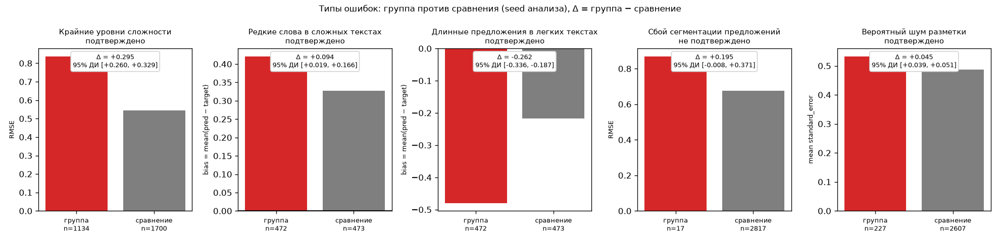
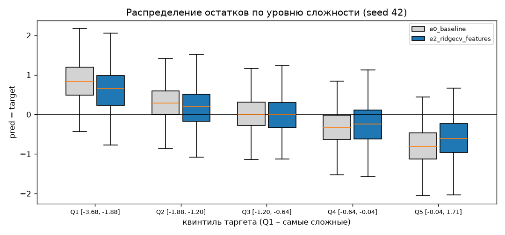
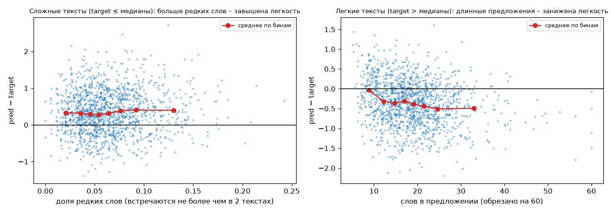
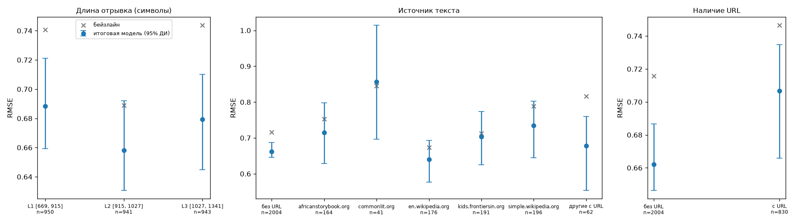
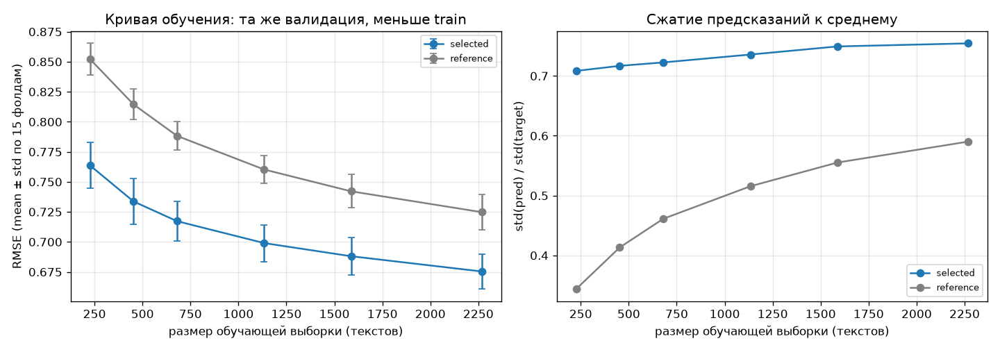
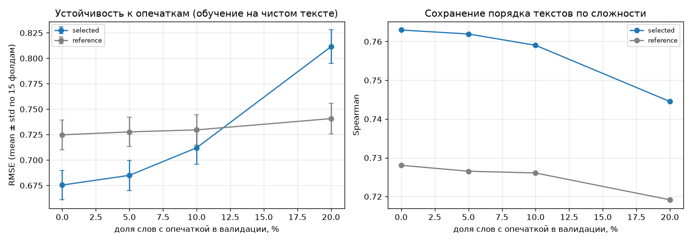
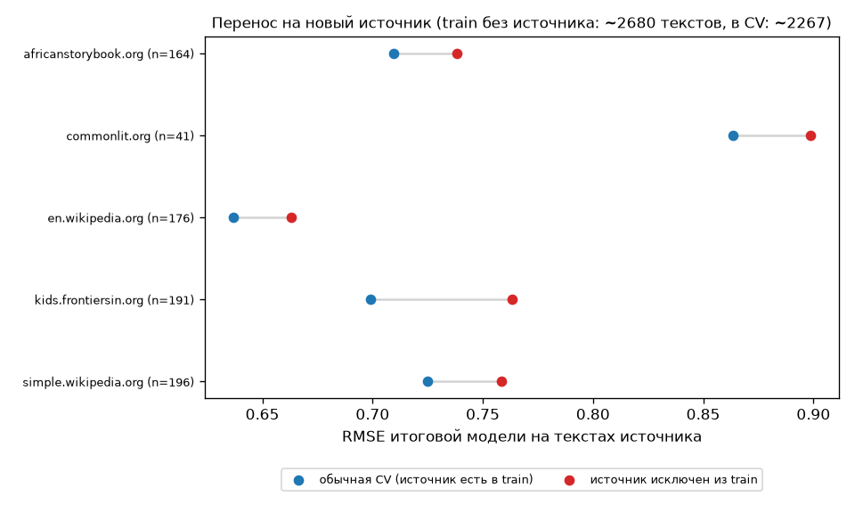

# CommonLit Readability – ДЗ№3

Продолжение [ДЗ№2](../baseline_improvement_experiments/report.md): исследуются ошибки, устойчивость и границы применимости итоговой модели ДЗ2.

Итог: модель стабильно ошибается на краях шкалы сложности и на легких текстах с длинными предложениями. Она устойчива к смене разбиения и монотонно улучшается с ростом данных, но чувствительна к опечаткам: при 20% искаженных слов становится хуже бейзлайна. На текстах из новых источников обычная CV оптимистична примерно на 0.03 RMSE. Найдена утечка через почти-дубликаты.

## Содержание

1. [Выбранное решение и протокол анализа](#1-выбранное-решение-и-протокол-анализа)
2. [Анализ ошибок](#2-анализ-ошибок)
3. [Диагностика по срезам](#3-диагностика-по-срезам)
4. [Проверки устойчивости](#4-проверки-устойчивости)
5. [Ограничения модели](#5-ограничения-модели)
6. [Выводы](#6-выводы)
7. [Запуск и артефакты](#7-запуск-и-артефакты)

---

## 1. Выбранное решение и протокол анализа

Анализируется итоговая модель ДЗ2 – эксперимент `e2_ridgecv_features` - далее Е2:

| | |
|---|---|
| Модель | TF-IDF (слова и биграммы) + 12 readability-признаков (стандартизация внутри фолда) + Ridge с вложенным подбором alpha |
| Метрика | RMSE 0.6754 ± 0.0145 по 15 фолдам (5-fold x 3 сида) |
| Почему она | лучшая модель ДЗ2, оба улучшения значимы по парному bootstrap |
| Для сравнения | бейзлайн E0 (TF-IDF + Ridge, alpha = 1.0), RMSE 0.7248 |

Протокол:

- Анализ ошибок и срезы строятся по OOF-предсказаниям ДЗ2 на тех же фолдах (хэш `folds.csv` проверяется). Модель не переобучается, тест не используется.
- Большая ошибка – |pred − target| ≥ 1.0, около 1.5 RMSE.
- Доверительные интервалы – bootstrap, 2000 ресемплов, 95%.
- Все правила зафиксированы в [`configs/analysis/hw3.yaml`](../../configs/analysis/hw3.yaml) до первого запуска.
- Для проверок устойчивости модель переобучается с той же конфигурацией. При 100% train и без опечаток переобученная модель воспроизводит OOF-предсказания ДЗ2 вточности.

Число групп в срезах выбрано как компромисс между детальностью и размером групп.

---

## 2. Анализ ошибок

Большая ошибка у 13.8% текстов, у 10.3% – на всех трех сидах. Большинство крупных ошибок – свойство самих текстов, а не случайность разбиения.

Ошибки разобраны по 5 типам. Каждый тип задан измеримым правилом и проверяется сравнением "группа против контрольной группы" с bootstrap-ДИ разницы.

| Тип | Группа (n) | Сравнение (n) | Метрика | Группа | Сравнение | Δ [95% ДИ] | Статус |
|---|---|---|---|---|---|---|---|
| Крайние уровни сложности | Q1 и Q5 таргета (1134) | Q2–Q4 (1700) | RMSE | 0.838 | 0.543 | +0.295 [+0.260, +0.329] | подтверждено |
| Редкая лексика в сложных текстах | сложная половина, верхняя треть по доле редких слов (472) | сложная половина, нижняя треть (473) | смещение | +0.421 | +0.327 | +0.094 [+0.019, +0.166] | формально подтверждено, но объясняется уровнем сложности|
| Длинные предложения в легких текстах | легкая половина, верхняя треть по длине предложений (472) | легкая половина, нижняя треть (473) | смещение | −0.480 | −0.218 | −0.262 [−0.336, −0.187] | подтверждено |
| Сбой сегментации предложений | > 60 слов в предложении или Flesch < 0 (17) | остальные (2817) | RMSE | 0.870 | 0.675 | +0.195 [−0.008, +0.371] | не подтверждено |
| Вероятный шум разметки | большая ошибка на всех сидах у E2 и бейзлайна, в одну сторону (227) | остальные (2607) | средний SE | 0.533 | 0.488 | +0.045 [+0.039, +0.051] | формально подтверждено, но смешано с уровнем сложности|

Смещение = mean(pred − target): положительное – модель считает текст легче, чем он размечен.



### 2.1. Крайние уровни сложности – подтверждено

Самые сложные и самые легкие 20% текстов: RMSE 0.84 против 0.54 в центре, доля больших ошибок 24% против 7%. Самые сложные тексты предсказываются легче, чем есть (смещение +0.62 в Q1), самые легкие – сложнее (−0.61 в Q5).

| Текст | target | E2 | бейзлайн | Объяснение |
|---|---|---|---|---|
| "Probably the most widely accepted theory explaining the evolution of larval stages is the need for dispersal. Sessile organisms such as barnacles and tunicates…" (Simple Wikipedia) | −2.78 | −0.31 | −0.52 | синтаксис простой, сложность – в терминах (sessile, tunicates, pelagic); ошибка стабильна на всех сидах |
| "Yuadoo is scared of the dark. Everyone feels fear sometimes. But Yuadoo can ask for help…" (African Storybook) | −2.20 | +0.52 | +0.18 | очень короткие предложения и простые слова, но метка "сложный" – вероятный шум разметки (гипотеза) |

Причина (подтверждено в ДЗ2): при R² = 0.57 предсказания неизбежно сжимаются к среднему, а калибровка итоговой модели уже почти идеальна (наклон 1.003). Это ограничение силы модели, а не ее настройки. Улучшения ДЗ2 уменьшили ошибку на краях (Q1: 0.99 → 0.85, Q5: 0.94 → 0.83), но не устранили ее.




### 2.2. Редкая лексика в сложных текстах – эффект объясняется уровнем сложности

Доля редких слов – доля слов, встречающихся не более чем в двух текстах корпуса.

Однако тексты с большим числом редких слов в среднем еще и сложнее: средний таргет −1.97 против −1.68. Только из-за регрессии к среднему это дает ожидаемую разницу смещений 0.43 · 0.29 ≈ +0.12, что не меньше наблюдаемой +0.09. Вывод: отдельного эффекта редкой лексики сверх уровня сложности данные не показывают.

Кроме того, "редкие слова" – это не только термины. В примерах они включают имена собственные (Yuadoo, Chidubem в детском тексте) и устаревшую лексику:

| Текст | target | E2 | бейзлайн | Объяснение |
|---|---|---|---|---|
| "I've plucked the berry from the bush, the brown nut from the tree, But heart of happy little bird ne'er broken was by me…" (стихотворение) | −2.67 | −0.63 | −0.88 | архаичные формы (ne'er, couching) и поэтический синтаксис; поверхностные признаки (короткие слова, высокий Flesch 82) указывают на легкий текст |
| "Probably the most widely accepted theory… larval stages…" | −2.78 | −0.31 | −0.52 | терминология |

Гипотеза, которую данные не опровергают, но и не подтверждают отдельно: модель не знает, что редкие слова трудны. TF-IDF их отбрасывает (`min_df = 2`) или дает им малый вес, а список Dale–Chall не различает термин, имя и опечатку.



### 2.3. Длинные предложения в легких текстах – подтверждено

Среди легких текстов в верхней трети по длине предложений смещение −0.48, в нижней – −0.22 (разница −0.26, ДИ исключает 0), доля больших ошибок 19.5% против 10.4%. График показывает монотонный рост ошибки с длиной предложения.

Эффект не объясняется уровнем сложности, а скорее недооценен: тексты группы в среднем чуть сложнее контрольных (−0.28 против +0.08), что по оценке выше должно было сдвинуть их смещение в положительную сторону, а наблюдается сдвиг в отрицательную.

| Текст | target | E2 | бейзлайн | Объяснение |
|---|---|---|---|---|
| "Aladdin's Mother burst out laughing at the idea of her son wishing to be the son-in-law of the Sultan, and told him to put such thoughts out of his head at once…" | +0.65 | −1.36 | −1.22 | длинные предложения со служебными словами (which, that, of), но знакомый сказочный сюжет |
| "Midas was enjoying himself in his treasure-room, one day, as usual, when he perceived a shadow fall over the heaps of gold…" | +0.94 | −0.89 | −1.05 | то же: длинный синтаксис, простое повествование |
| "The Pony Express was the first rapid transit and the first fast mail line across the continent…" | +0.31 | −1.88 | −1.70 | длинные описательные предложения, но аннотаторы сочли текст легким |

Причина (гипотеза, согласующаяся с данными): модель оценивает сложность по форме – длина предложений, служебные слова, формулы Flesch, – а аннотаторы учитывают знакомость сюжета и жанра. Для сказок и простых историй длинное предложение не делает текст трудным. Readability-признаки ДЗ2 здесь не помогают и даже усиливают ошибку: E2 предсказывает Аладдина сложнее бейзлайна.

### 2.4. Сбой сегментации предложений – не подтверждено

Правило отбирает тексты с аномальными признаками (> 60 слов в предложении или отрицательный Flesch). Таких текстов всего 17. RMSE у них 0.87 против 0.68, ДИ разницы включает 0 – выборка слишком мала для вывода.

| Текст | target | E2 | бейзлайн | Объяснение |
|---|---|---|---|---|
| "When I think of the flag that those ships carry, the only touch of color about them, the only thing that moves as if it had a settled spirit in it…" (речь, 91 слово в предложении, Flesch −4.7) | −0.93 | −2.31 | −1.17 | одно очень длинное риторическое предложение дает экстремальные признаки; E2 ошибается намного сильнее бейзлайна (−1.38 против −0.25) – признаки выходят далеко за типичный диапазон, и линейная модель их экстраполирует |
| "Molecular nanotechnology (MNT) is a technology based on the ability to build structures to complex, atomic specifications by means of mechanosynthesis…" (Flesch −11.5) | −3.55 | −2.34 | −1.84 | отрицательный Flesch здесь не сбой, а действительно трудный текст; правило смешивает два случая |

Вывод: аномальные значения признаков – правдоподобный источник отдельных крупных ошибок, но статистически это не подтверждено. Само правило недостаточно точно: оно ловит и сбои сегментации, и реально трудные тексты.

### 2.5. Вероятный шум разметки – не отделен от уровня сложности

227 текстов, на которых и итоговая модель, и бейзлайн ошибаются больше чем на 1.0 на всех трех сидах и в одну сторону. Две разные модели, обученные на разных данных, согласно "не верят" метке. Средний SE у них 0.533 против 0.488, разница значима.

Но и этот результат смешан с уровнем сложности: такие тексты сосредоточены на обоих краях шкалы, а SE там выше сам по себе (U-образная зависимость из EDA). Срез 3.4 проверяет это внутри уровня сложности и показывает, что смешение действительно сильное. Поэтому вывод о шуме разметки по этому типу – гипотеза, а не подтвержденный факт.

Прямое свидетельство шума дают почти-дубликаты (TF-IDF cosine similarity ≥ 0.9, найдено 2 пары, [`tables/near_duplicates.csv`](tables/near_duplicates.csv)):

| Пара | target A | target B | pred A | pred B |
|---|---|---|---|---|
| "Goat, Dog and Cow were great friends. One day they went on a journey in a taxi…" (similarity 1.00) | +0.81 | +0.10 | +0.14 | +0.73 |
| "When the two friends had thus become reconciled, they examined the cub…" (similarity 0.94) | −0.81 | −0.86 | −0.87 | −0.67 |

В первой паре практически один и тот же текст получил оценки, различающиеся на 0.71 – это нижняя граница шума разметки, который никакая модель не устранит. Кроме того, предсказание для каждого текста почти совпадает с меткой его двойника (0.14 ≈ 0.10 и 0.73 ≈ 0.81): двойник был в обучающей части фолда, и модель воспроизвела его метку. Это утечка через дубликаты (раздел 5).

---

## 3. Диагностика по срезам

Для каждой группы: n, средний таргет, RMSE итоговой модели с 95% ДИ, смещение и RMSE бейзлайна.

### 3.1. Уровень сложности

| Квинтиль таргета | n | Средний таргет | RMSE [95% ДИ] | Смещение | RMSE бейзлайна |
|---|---|---|---|---|---|
| Q1 [−3.68, −1.88] (самые сложные) | 567 | −2.45 | 0.854 [0.810, 0.898] | +0.62 | 0.991 |
| Q2 [−1.88, −1.20] | 567 | −1.53 | 0.550 [0.525, 0.587] | +0.19 | 0.521 |
| Q3 [−1.20, −0.64] | 566 | −0.91 | 0.486 [0.457, 0.515] | 0.00 | 0.429 |
| Q4 [−0.64, −0.04] | 567 | −0.36 | 0.575 [0.549, 0.617] | −0.24 | 0.553 |
| Q5 [−0.04, 1.71] (самые легкие) | 567 | +0.46 | 0.825 [0.781, 0.861] | −0.61 | 0.940 |

U-образная зависимость, ДИ краев и центра не пересекаются. Итоговая модель заметно лучше бейзлайна на краях (−0.14 и −0.12), но немного хуже в Q2–Q4 – это компромисс калибровки, описанный в ДЗ2: менее сжатые предсказания сильнее разбросаны и в центре.

### 3.2. Длина отрывка

| Терциль длины (символы) | n | Средний таргет | Доля с URL | RMSE [95% ДИ] | Смещение | RMSE бейзлайна |
|---|---|---|---|---|---|---|
| L1 [669, 915] (короткие) | 950 | −0.57 | 18% | 0.688 [0.659, 0.721] | −0.02 | 0.741 |
| L2 [915, 1027] | 941 | −0.92 | 27% | 0.658 [0.631, 0.692] | +0.02 | 0.689 |
| L3 [1027, 1341] (длинные) | 943 | −1.39 | 43% | 0.679 [0.645, 0.710] | −0.01 | 0.744 |

Ошибка от длины отрывка не зависит – ДИ всех групп пересекаются, смещение около нуля. Но средний таргет резко падает с длиной: длинные отрывки в среднем сложнее. Это объясняет, почему группа признаков длины дала наибольший уникальный вклад в ДЗ2: длина предсказывает метку, а не является зоной ошибок. Является ли это реальным свойством читаемости или особенностью нарезки корпуса, по имеющимся данным не установить.

### 3.3. Источник текста

| Источник | n | Средний таргет | RMSE [95% ДИ] | Смещение | RMSE бейзлайна |
|---|---|---|---|---|---|
| без URL | 2004 | −1.08 | 0.662 [0.646, 0.688] | +0.04 | 0.716 |
| с URL (все) | 830 | −0.66 | 0.707 [0.666, 0.735] | −0.12 | 0.747 |
| en.wikipedia.org | 176 | −1.62 | 0.640 [0.577, 0.694] | −0.14 | 0.674 |
| kids.frontiersin.org | 191 | −0.51 | 0.703 [0.625, 0.774] | −0.19 | 0.713 |
| africanstorybook.org | 164 | +0.09 | 0.715 [0.628, 0.797] | +0.01 | 0.753 |
| simple.wikipedia.org | 196 | −0.84 | 0.734 [0.645, 0.803] | −0.01 | 0.789 |
| commonlit.org | 41 | −0.55 | 0.857 [0.697, 1.014] | −0.46 | 0.846 |
| другие с URL | 62 | +0.10 | 0.678 [0.553, 0.759] | −0.28 | 0.816 |

- Тексты с URL (прокси современных, доля которых выше в тесте) предсказываются немного хуже и с отрицательным смещением – модель считает их сложнее, чем они есть. ДИ двух групп слегка пересекаются, поэтому это тенденция, а не строгий результат.
- Худший источник – commonlit.org (0.857, смещение −0.46), причем здесь итоговая модель не лучше бейзлайна. Но группа мала (41 текст), ДИ очень широкий.
- Научно-популярные тексты Frontiers в среднем предсказываются сложнее, чем размечены (−0.19). Это уточняет ДЗ2: отдельные научные тексты с терминами переоцениваются как легкие, но для источника в целом смещение обратное.
- Итоговая модель лучше бейзлайна почти во всех источниках, кроме commonlit.org; выигрыш на Frontiers минимален (0.01).



---

## 4. Проверки устойчивости

Каждая проверка меняет один фактор. Конфигурация модели та же, без дополнительного подбора: вложенный подбор alpha – часть зафиксированной процедуры. Бейзлайн приведен для сравнения

Отдельно: устойчивость к смене разбиения уже проверена в ДЗ2 – разброс OOF RMSE итоговой модели по трем сидам 0.0022, по 15 фолдам - 0.0145.

### 4.1. Размер обучающей выборки

- Исходное условие: обучение на всей train-части фолда.
- Изменение: 10, 20, 30, 50, 70% train-части. Подвыборки вложены (меньшая входит в большую), фиксированный seed. Валидационные фолды те же.

| Доля train | Текстов | E2: RMSE ± std | E2: Spearman | E2: std ratio | E2: alpha (медиана) | Бейзлайн: RMSE ± std | Бейзлайн: std ratio |
|---|---|---|---|---|---|---|---|
| 10% | 227 | 0.764 ± 0.019 | 0.693 | 0.71 | 0.001 | 0.852 ± 0.013 | 0.34 |
| 20% | 453 | 0.734 ± 0.019 | 0.717 | 0.72 | 0.001 | 0.815 ± 0.013 | 0.41 |
| 30% | 680 | 0.717 ± 0.016 | 0.730 | 0.72 | 0.001 | 0.788 ± 0.012 | 0.46 |
| 50% | 1134 | 0.699 ± 0.015 | 0.746 | 0.74 | 0.068 | 0.760 ± 0.011 | 0.52 |
| 70% | 1587 | 0.688 ± 0.016 | 0.754 | 0.75 | 0.100 | 0.742 ± 0.014 | 0.56 |
| 100% | 2267 | 0.675 ± 0.015 | 0.763 | 0.75 | 0.147 | 0.725 ± 0.015 | 0.59 |




- Обе модели монотонно улучшаются, и плато не достигнуто: переход от 70% к 100% еще дает −0.013. Больше данных, вероятно, улучшило бы модель, то есть решение частично ограничено объемом данных.
- Преимущество итоговой модели над бейзлайном максимально на малых данных (0.089 при 10%) и сокращается до 0.049 при 100%. Readability-признаки особенно полезны, когда текстов мало.
- У бейзлайна с фиксированной alpha = 1.0 на малых данных предсказания катастрофически сжаты (std ratio 0.34), у итоговой модели масштаб стабилен (0.71–0.75): вложенный подбор alpha подстраивает регуляризацию под объем данных.
- При 10–30% train выбранная alpha упирается в нижнюю границу сетки (0.001). Сетка зафиксирована в ДЗ2 для полного объема данных; расширять ее в ДЗ3 нельзя (это был бы дополнительный подбор), поэтому результаты на малых долях получены процедурой с ограниченной сеткой.

### 4.2. Опечатки во входном тексте

- Исходное условие: чистый текст.
- Изменение: модель обучается на чистой train-части, а в валидационных текстах каждое слово длиной от 3 букв с вероятностью 5, 10 или 20% получает одну случайную правку – перестановку соседних букв, удаление, замену или вставку буквы (фиксированный seed на текст). Признаки пересчитываются по искаженному тексту.
- Пример при 20%: "When the yuong people returnde to the ballroom, it presented a decieddly changed appearance…"

| Доля слов с опечаткой | E2: RMSE ± std | E2: Δ | E2: Spearman | E2: смещение | Бейзлайн: RMSE ± std | Бейзлайн: Δ | Бейзлайн: смещение |
|---|---|---|---|---|---|---|---|
| 0% | 0.675 ± 0.015 | – | 0.763 | −0.01 | 0.725 ± 0.015 | – | +0.01 |
| 5% | 0.685 ± 0.015 | +0.010 | 0.762 | −0.11 | 0.728 ± 0.014 | +0.003 | −0.00 |
| 10% | 0.712 ± 0.016 | +0.037 | 0.759 | −0.21 | 0.730 ± 0.015 | +0.005 | −0.02 |
| 20% | 0.811 ± 0.016 | +0.136 | 0.745 | −0.41 | 0.741 ± 0.015 | +0.016 | −0.04 |




- Итоговая модель заметно менее устойчива, чем бейзлайн: при 20% опечаток ее ошибка растет на 0.136 против 0.016, и уже примерно с 12% она хуже бейзлайна.
- Порядок текстов сохраняется почти полностью (Spearman 0.763 → 0.745), а смещение растет линейно (−0.01 → −0.41): опечатки систематически сдвигают все предсказания в сторону "сложнее". Это подтверждает, что ломается масштаб, а не ранжирование.
- Механизм (гипотеза, согласующаяся с направлением сдвига): слово с опечаткой выпадает из списка знакомых слов Dale–Chall и считается трудным, меняется число слогов и букв на слово. Readability-признаки дружно указывают на более сложный текст. Для TF-IDF опечатка – просто пропавшее слово, поэтому бейзлайн почти не реагирует
### 4.3. Перенос на новый источник

- Исходное условие: обычная CV, тексты источника есть в обучении.
- Изменение: все тексты одного источника (домены с n ≥ 30) исключаются из обучения, модель обучается на остальных и предсказывает этот источник. Сравнение – с OOF ДЗ2 на тех же текстах; ДИ – парный bootstrap.
- Обучающая выборка при этом больше (≈2640–2790 текстов против ≈2267 в CV), то есть сравнение скорее в пользу исключения источника.

| Источник | n | E2: RMSE CV | E2: RMSE без источника | E2: Δ [95% ДИ] | Бейзлайн: Δ [95% ДИ] |
|---|---|---|---|---|---|
| kids.frontiersin.org | 191 | 0.699 | 0.763 | +0.064 [+0.036, +0.091] | +0.040 [+0.024, +0.058] |
| simple.wikipedia.org | 196 | 0.725 | 0.759 | +0.033 [+0.013, +0.054] | +0.053 [+0.035, +0.071] |
| africanstorybook.org | 164 | 0.710 | 0.738 | +0.029 [−0.001, +0.057] | +0.023 [+0.007, +0.041] |
| en.wikipedia.org | 176 | 0.637 | 0.663 | +0.026 [+0.007, +0.047] | +0.025 [+0.007, +0.043] |
| commonlit.org | 41 | 0.863 | 0.899 | +0.035 [−0.010, +0.081] | +0.008 [−0.014, +0.032] |




- Для всех источников ошибка растет (+0.026…+0.064), значимо – для трех из пяти, еще у одного нижняя граница ДИ около 0. И это при большей обучающей выборке.
- Обычная случайная CV оптимистична для текстов из источников, которых нет в обучении, примерно на 0.03 RMSE. Модель частично использует стиль и лексику, специфичные для источника.
- Сильнее всего падает качество на Frontiers (+0.064), причем у итоговой модели сильнее, чем у бейзлайна. Признаки ДЗ2 частично подстраиваются под стиль источника.

---

## 5. Ограничения модели

### Границы применимости

- Английские отрывки около 175 слов из школьной литературы, научно-популярных и образовательных источников. Для других длин, жанров и языков модель не проверялась.
- Хуже всего работает на краях шкалы сложности (RMSE ≈0.83–0.85 против ≈0.49 в центре): очень сложные тексты систематически получают оценку "легче", очень легкие – "сложнее".
- Систематически ошибается на легких текстах с длинными предложениями (сказки, простые истории) и на текстах с аномальной структурой (риторические речи, стихи).
- Требует чистого текста: уже 10% опечаток (OCR, распознавание речи, пользовательский ввод) заметно ухудшают и смещают оценки, при 20% модель хуже бейзлайна.

### Источники ошибок

- Шум разметки: один и тот же текст получил оценки, различающиеся на 0.7; типичный SE около 0.49 сопоставим с RMSE модели. Часть ошибки неустранима.
- Постановка таргета: оценки получены из попарных сравнений, и неопределенность выше на краях шкалы, там же, где модель ошибается сильнее всего. Разделить шум и ограничение модели на краях не удалось.
- Модель видит форму текста, а не смысл: служебные слова, длина, слоги, формулы читаемости. Знакомость сюжета, терминология и стилистика недоступны.
- Объем данных: кривая обучения не вышла на плато.

### Риски практического применения

- Подбор текстов для детей: сжатие оценок на краях означает, что очень трудный текст может получить "средний" уровень и попасть к слабому читателю. Нужен запас на ошибку или ручная проверка крайних оценок.
- Ранжирование надежнее абсолютных значений: Spearman устойчив даже к опечаткам, тогда как масштаб сдвигается. Для практики безопаснее использовать модель для сравнения текстов между собой, чем для присвоения уровня.
- Неравномерное качество по источникам: для части источников (commonlit.org, малые группы) качество хуже и оценено ненадежно.
- Для применения на текстах из новых источников или жанров нужна отдельная валидация на них.

### Утечки данных и их контроль

| Источник утечки | Контроль | Остаточный риск |
|---|---|---|
| Метаданные (`url_legal`, `license`, `standard_error`) коррелируют с таргетом | в модель не подаются, используются только для анализа | нет |
| Preprocessing на всех данных | TF-IDF, scaler и подбор alpha обучаются только на train-части фолда | нет |
| Подбор по тесту | тест и leaderboard не используются; все выводы – по OOF на фиксированных фолдах | нет |
| Почти-дубликаты в разных фолдах | обнаружены (2 пары) | модель воспроизводит метку двойника; на общую метрику почти не влияет, но для дубликатов оценка CV искажена |
| Тексты одного источника в разных фолдах | проверено исключением источника | CV оптимистична для новых источников на ≈0.03 RMSE; для корректной оценки обобщения нужна группировка по источнику там, где он известен (для 70% текстов источник неизвестен) |

---

## 6. Выводы

Анализ ошибок.
- Подтверждены два типа ошибок: крайние уровни сложности и длинные предложения в легких текстах. Второй – наиболее содержательный: модель путает длину конструкций со сложностью там, где аннотаторы учитывают знакомость сюжета.
- Два типа, формально подтвержденные (редкая лексика и шум разметки), при учете уровня сложности объясняются регрессией к среднему или не отделяются от нее. Без такой проверки их легко принять за самостоятельные причины ошибок.
- Сбой сегментации не подтвержден из-за малой группы.
- Найдена утечка через почти-дубликаты и прямое свидетельство шума разметки (0.7 на одном тексте).

Срезы.
- Ошибка зависит от уровня сложности (U-форма), но не от длины отрывка. Длина связана с самой меткой, что объясняет ее вклад в ДЗ2.
- Тексты с URL (современные) предсказываются немного хуже и со смещением в сторону "сложнее".
- Влияние шума разметки на краях шкалы переплетено с экстремальностью текстов.

Устойчивость.
- Устойчивые стороны: стабильность по разбиениям (std по сидам 0.002), монотонное улучшение с ростом данных, стабильный масштаб предсказаний даже на малых данных, сохранение ранжирования при искажениях.
- Слабые стороны: чувствительность к опечаткам из-за readability-признаков и оптимистичность CV для новых источников.

Модели можно доверять как инструменту ранжирования чистых текстов из знакомых источников в середине шкалы сложности. Абсолютные оценки на краях шкалы, оценки искаженных текстов и текстов из новых источников требуют осторожности.

---

## 7. Запуск

```bash
bash scripts/run_analysis.sh
```