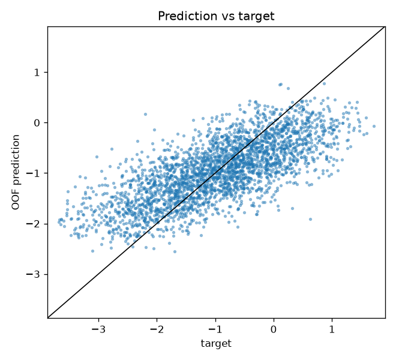
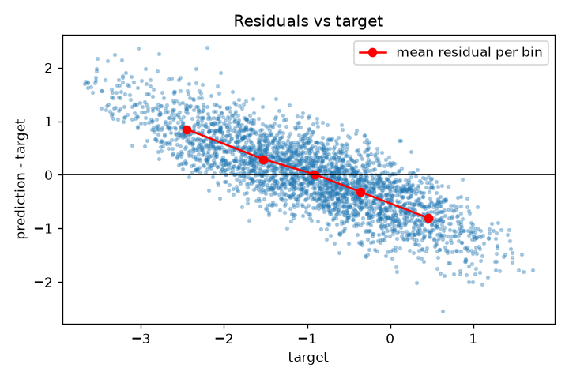
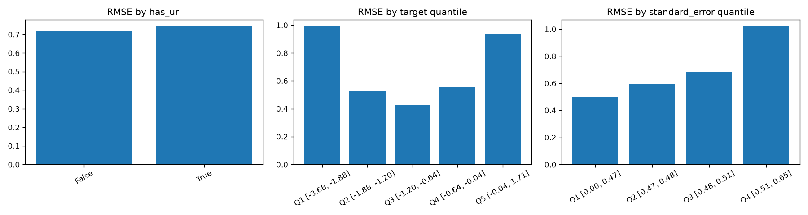
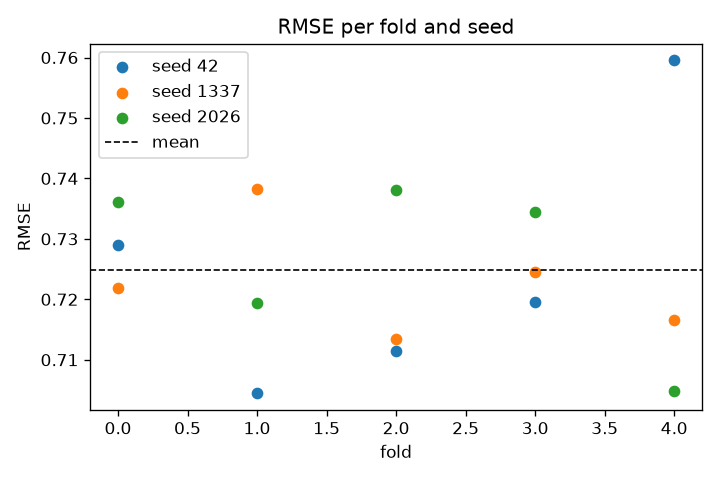

# Results: tfidf_ridge

Model: `tfidf_ridge`, params: `{"ngram_range": [1, 2], "min_df": 2, "max_features": 50000, "sublinear_tf": true, "lowercase": true, "alpha": 1.0}`
CV: 5-fold stratified by 10 target quantiles, seeds [42, 1337, 2026] (15 folds total).

## Per-fold metrics (mean ± std over all folds and seeds)

| metric | mean | std |
|---|---|---|
| rmse | 0.7248 | 0.0148 |
| mae | 0.5785 | 0.0125 |
| r2 | 0.5077 | 0.0198 |
| pearson | 0.7256 | 0.0163 |
| spearman | 0.7281 | 0.0186 |
| dummy_rmse | 1.0333 | 0.0145 |
| fit_time_s | 0.6736 | 0.0422 |

`dummy_rmse` – sanity check: constant prediction equal to the train-fold mean.

## OOF RMSE per seed with 95% bootstrap CI (2000 resamples)

| seed | oof_rmse | ci_low | ci_high |
|---|---|---|---|
| 42 | 0.7251 | 0.7066 | 0.7438 |
| 1337 | 0.7230 | 0.7048 | 0.7418 |
| 2026 | 0.7267 | 0.7085 | 0.7452 |

OOF RMSE across seeds: 0.7249 ± 0.0018

## Error analysis by slices (OOF, seed 42)

`bias` = mean(prediction - target); positive means predicted easier than labeled.

### has_url

| slice | n | rmse | mae | bias |
|---|---|---|---|---|
| False | 2004 | 0.7175 | 0.5722 | 0.0765 |
| True | 830 | 0.7430 | 0.5948 | -0.1638 |

### target quantile

| slice | n | rmse | mae | bias |
|---|---|---|---|---|
| Q1 [-3.68, -1.88] | 567 | 0.9904 | 0.8605 | 0.8518 |
| Q2 [-1.88, -1.20] | 567 | 0.5228 | 0.4232 | 0.2922 |
| Q3 [-1.20, -0.64] | 566 | 0.4272 | 0.3426 | 0.0107 |
| Q4 [-0.64, -0.04] | 567 | 0.5563 | 0.4493 | -0.3193 |
| Q5 [-0.04, 1.71] | 567 | 0.9390 | 0.8181 | -0.8047 |

### standard_error quantile

| slice | n | rmse | mae | bias |
|---|---|---|---|---|
| Q1 [0.00, 0.47] | 709 | 0.4971 | 0.3963 | 0.0007 |
| Q2 [0.47, 0.48] | 708 | 0.5918 | 0.4749 | -0.0250 |
| Q3 [0.48, 0.51] | 708 | 0.6818 | 0.5537 | -0.0177 |
| Q4 [0.51, 0.65] | 709 | 1.0200 | 0.8902 | 0.0666 |

## Shrinkage toward the mean

std(prediction) / std(target) = 0.591; slope of residual vs target = -0.571 (0 means no systematic shrinkage).

## Largest errors (OOF, seed 42)

- **predicted too easy** | id `8fb1cf05f` | target -2.199 | pred 0.175 | residual +2.374 | SE 0.480 | has_url True
  > Yuadoo is scared of the dark. Everyone feels fear sometimes. But Yuadoo can ask for help. Chidubem is worried about his schoolwork. He can tell his teacher. He can ask for help. Lushan is playing around! It's okay to be silly sometimes. Eruro is feeling sad. It's okay to cry. Emotions come and go. A...

- **predicted too easy** | id `a24031f43` | target -3.032 | pred -0.673 | residual +2.358 | SE 0.648 | has_url True
  > To study TBI, scientists often look at specific brain proteins called biomarkers. Biomarkers are a measure of a disease process, usually measured after focal injury. A typical biomarker would be the level of your blood glucose as a way to monitor diabetes. In TBI, the biomarkers we are interested in...

- **predicted too easy** | id `03b761fd9` | target -2.779 | pred -0.522 | residual +2.256 | SE 0.533 | has_url True
  > Probably the most widely accepted theory explaining the evolution of larval stages is the need for dispersal. Sessile organisms such as barnacles and tunicates, and sea-floor groups like mussels and crabs, need some way to move their young into new territory, since they cannot move long distances as...

- **predicted too hard** | id `24e00a515` | target 0.628 | pred -1.912 | residual -2.540 | SE 0.521 | has_url True
  > An inkpad is a small box which contains a pad of cloth or other material. It is impregnated with ink (the pad is inky). A marker is pressed onto the pad, then onto paper. Any raised marks on the pad leave an impression in ink on the paper. Ink pads are used with rubber stamps. On the stamp is the sy...

- **predicted too hard** | id `76f92b721` | target 1.103 | pred -0.945 | residual -2.049 | SE 0.554 | has_url False
  > The biggest desert in the world is in Africa, and is called the Sahara. It is almost as large as the Atlantic Ocean, but instead of water it is all sands and rocks. Like the ocean, it is visited with storms; dreadful gales, when the wind scoops up thousands of tons of sand and drives them forward, b...

- **predicted too hard** | id `5a358c889` | target 0.314 | pred -1.697 | residual -2.011 | SE 0.543 | has_url False
  > The Pony Express was the first rapid transit and the first fast mail line across the continent from the Missouri River to the Pacific Coast. It was a system by means of which messages were carried swiftly on horseback across the plains and deserts, and over the mountains of the far West. It brought ...

## Top terms of the full-data model

### Easier (positive coefficients)

| term | coef |
|---|---|
| you | 1.3427 |
| she | 1.0850 |
| one day | 1.0408 |
| do | 1.0095 |
| said | 1.0011 |
| they | 0.9973 |
| mother | 0.9942 |
| just | 0.9756 |
| get | 0.9654 |
| can | 0.9375 |
| people | 0.9359 |
| could | 0.8942 |
| very | 0.8637 |
| eat | 0.8603 |
| school | 0.8419 |
| help | 0.8341 |
| also | 0.8302 |
| think | 0.8038 |
| lived | 0.7837 |
| boy | 0.7827 |

### Harder (negative coefficients)

| term | coef |
|---|---|
| of | -1.7009 |
| which | -1.4851 |
| with | -1.4206 |
| as | -1.1817 |
| of the | -1.0885 |
| by | -1.0562 |
| in | -0.9076 |
| at | -0.9051 |
| any | -0.8931 |
| its | -0.8907 |
| with the | -0.8747 |
| and the | -0.8598 |
| thus | -0.8433 |
| dr | -0.8402 |
| per | -0.7487 |
| such | -0.7468 |
| being | -0.7444 |
| and that | -0.7433 |
| or | -0.7376 |
| an | -0.7348 |

## Figures

